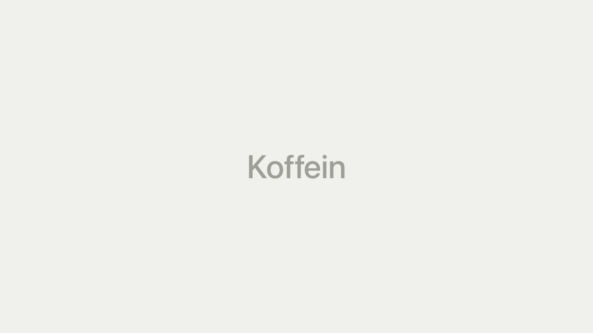
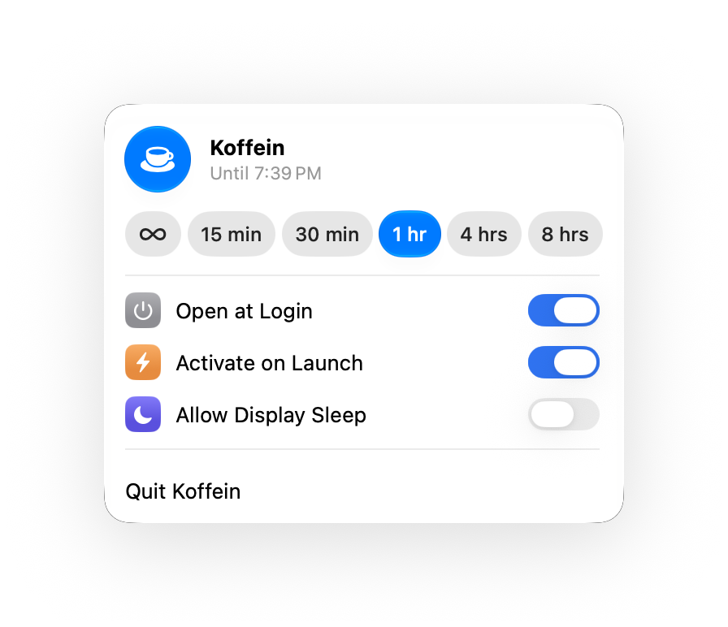

<p align="center">
  
</p>

Koffein is a small menu bar app that keeps your Mac awake, for as long as you need and no longer.

<p align="center">
  <picture>
    <source media="(prefers-color-scheme: dark)" srcset=".github/assets/menu-dark.png">
    
  </picture>
</p>

## Install

Download the latest version from [Releases](../../releases), unzip it and move Koffein to your Applications folder. It requires macOS 26 or later on Apple silicon.

Koffein adds itself as a login item and switches on the first time it runs, so it is already awake after a restart. You can turn both off from the menu.

## Build from source

```sh
git clone https://github.com/dhrubbe/koffein.git
cd koffein
./build-app.sh
```

The script compiles the app with the Xcode command line tools, signs it ad hoc, quits any running copy and opens the new build. The whole app lives in [`Sources/Koffein/main.swift`](Sources/Koffein/main.swift).

## How it works

Koffein holds an IOKit power assertion while it is on, the same mechanism `caffeinate` uses. Because the assertion belongs to the process, quitting or crashing releases it, so your Mac can never get stuck awake. Timers are checked against the clock when the Mac wakes, so a timer that ran out during sleep still switches Koffein off.

## License

[MIT](LICENSE)
